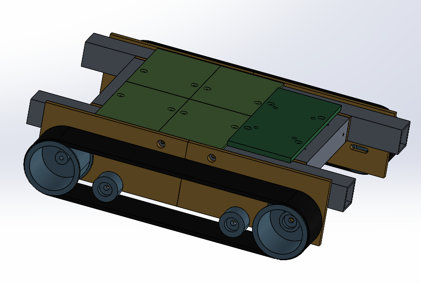
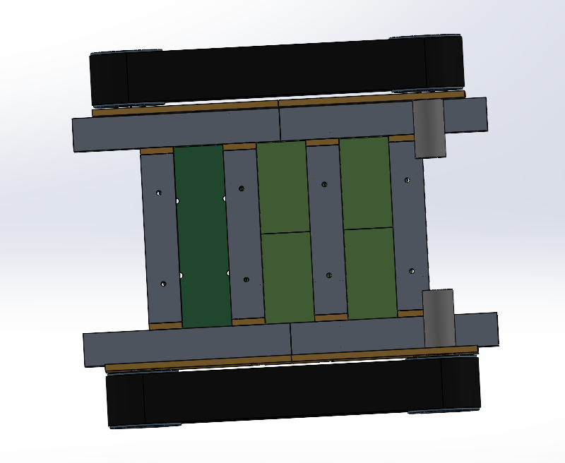
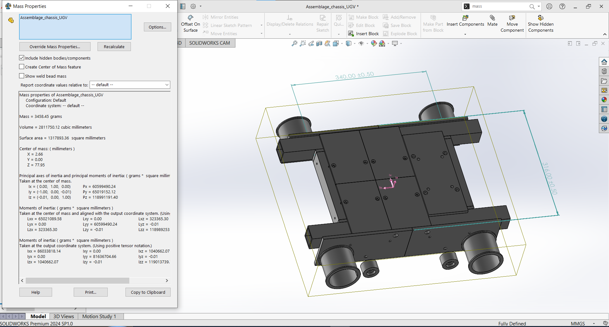

# Châssis mécanique — robot désherbeur autonome (UGV)

|  |  ||  
Partie mécanique du projet ENSEA *« Développement d'un robot autonome pour la détection et l'élimination des mauvaises herbes par vision artificielle »*
(équipe : Ryad KACHA, Wissem M'TIR, Mohamed Reda ZHAR, Omar MORAD).

Châssis en **PPA-CF** (impression 3D FDM) portant le bras Niryo Ned 1, l'électronique, la batterie et deux chenilles caoutchouc. Choix du matériau et dimensionnement du longeron : voir la note de cadrage (§4).

## Architecture

- 2 longerons tube 40×40×3 mm de 500 mm, chacun en 2 moitiés de 250 mm reliées par un manchon interne.
- 4 traverses (204 mm) fixées aux longerons par 8 embases à plot et poche d'écrou.
- Plaques latérales portant moteur, roues et galets, boulonnées sur la face extérieure des longerons.
- Plancher : 4 tuiles (zone arrière) + plaque d'embase du bras (zone avant).
- Dimensions hors tout : 500 × 454 mm, hauteur ≈ 118 mm hors bras.

**Repère global** : origine au sol, au centre du châssis ; X vers l'avant (bras), Y vers la gauche, Z vers le haut.

## Pièces imprimées

| Réf | Pièce | Qté | Hors tout (mm) | Orientation d'impression |
|---|---|---|---|---|
| P01A | Longeron arrière | 2 | 250×40×40 | à plat |
| P01B | Longeron avant | 2 | 250×40×40 | à plat |
| P02 | Manchon de raccord | 2 | 120×33,4×33,4 | à plat |
| P03 | Traverse | 4 | 204×40×40 | à plat |
| P04 | Embase de traverse | 8 | 48×40×40 | bride sur le plateau |
| P05 | Plaque d'embase du bras | 1 | 100×240×8 | à plat |
| P06 | Tuile de plancher | 4 | 100×150×4 | à plat + brim |
| P07A | Plaque latérale arrière | 2 | 225×105×8 | à plat |
| P07B | Plaque latérale avant | 2 | 225×105×8 | à plat |
| P08 | Roue motrice | 2 | Ø86×66 | âme sur le plateau |
| P09 | Roue libre (tendeur) | 2 | Ø86×66 | âme sur le plateau |
| P10 | Galet de support | 4 | Ø40×24 | axe vertical |

Plus grande pièce : 250 mm → imprimante de volume utile **≥ 256×256×256 mm**.
Masse imprimée ≈ 3,5 kg (100 % plein). Quantités et visserie détaillées dans le PDF.

## Impression (PPA-CF)

Buse trempée/rubis 275–290 °C, filament séché 80–100 °C pendant ≥ 8 h, enceinte chauffée, 6 périmètres, remplissage 80 % gyroïde (100 % près des fixations). Trous modélisés au nominal + 0,1 mm (M5 → Ø5,6) : ajuster après une pièce test. Imprimer d'abord un manchon (P02) et une embase (P04) pour valider les jeux (0,3 mm).

## Composants à acheter

2 motoréducteurs · 2 chenilles caoutchouc 60 mm · 12 roulements 608 · 6 axes M8×50 · boulons M5×60 (×8), M5×45 (×4), M5×50 (×12 dont 4 fraisés), M4×45 (×8), écrous frein correspondants · 4 inserts M5 laiton · 2 vis M4 sans tête.

## Montage (résumé)

1. Manchons P02 dans les longerons (2 vis M5×45 chacun).
2. Embases P04 sur les traverses P03 (1 boulon M4×45 par extrémité, écrou M5 dans la poche).
3. Traverses entre les longerons ; boulons M5×60 depuis l'extérieur à travers plaque P07 + longeron + bride.
4. Moteurs, roue motrice P08, galets P10, roue libre P09 ; poser et tendre les chenilles (trou oblong de P07B).
5. Plaque P05 et tuiles P06 sur les traverses (M5 fraisés) ; fixer le bras.

## ⚠ Hypothèses et points à confirmer

- Volume d'impression supposé de 256 mm (découpe des longerons en deux moitiés).
- **Plaque du bras (P05)** : les 4 trous Ø7 sont un emplacement **provisoire** — relever l'entraxe sur la fiche du Niryo Ned 1 avant impression.
- Moteur supposé de type 37D (alésage Ø12, 6×M3 sur Ø31, arbre Ø6) : adapter P07A et P08.
- Chenille caoutchouc de 60 mm (référence, pas, crampons à définir) ; batterie, cartes et capteurs : perçages des tuiles à définir.
- Propriétés du PPA-CF génériques (Re 110 MPa, E 9 GPa) : à remplacer par la fiche du filament acheté ; comportement anisotrope.
- Les trous du manchon, au milieu du longeron (flexion maximale), donnent un coefficient de sécurité estimé ≈ 4,7 (contre 14,7 pour le tube plein) : à valider par essai ou simulation.
- Aucune simulation éléments finis réalisée à ce stade.

Les cotes sont des paramètres en tête de chaque script ; adapter le chemin de sortie (`out`) si besoin.
